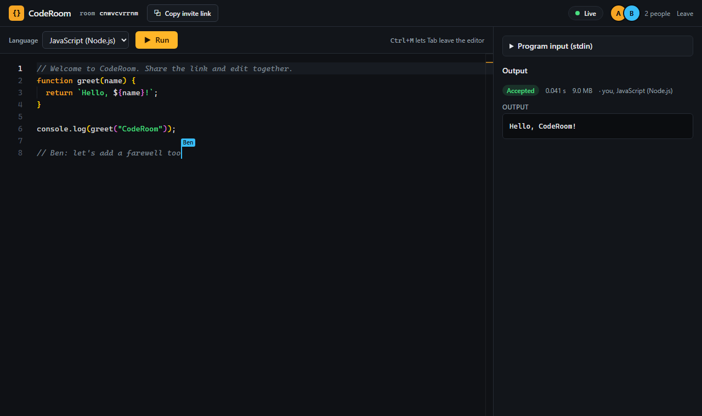
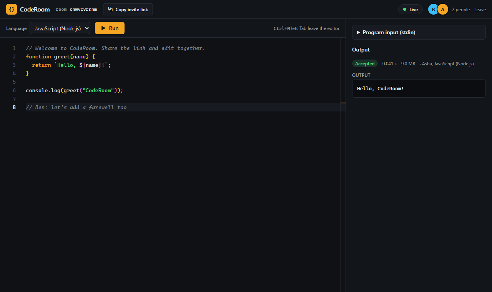

# CodeRoom

A real-time collaborative code editor. Create a room, share the link, and edit the same file together with live cursors, a shared language setting and shared run output.

> **Status (14 Nov 2026): source code only, not deployed.** There is no live link yet: the app (Vercel) and the sync server (Render) have not been deployed. **Run works without any server or account for JavaScript, TypeScript and Python** (in the browser, see "Running code" below). Java, C++, C, Go and Rust are editor-only unless a Judge0 endpoint is configured through `JUDGE0_URL`; none is configured here, and the Judge0 success path is only exercised with mocked responses.
>
> Checks re-run on 21 Nov 2026 (Windows, Node 22.20, Edge for Playwright): 87 Vitest tests, 8 sync-server tests (unchanged since 14 Nov) and 15 Playwright tests pass; lint, typecheck and build are clean; `npm audit --omit=dev --audit-level=high` reports 0 vulnerabilities for the app and the sync server.

| Asha's browser | Ben's browser (separate browser context) |
|---|---|
|  |  |

*Screenshots taken from the local production build with the real sync server. The "Accepted / Hello, CodeRoom!" output comes from a mocked `/api/run` response.*

## How it works

```mermaid
flowchart LR
  A[Browser A<br/>Monaco + y-monaco] <-- Yjs updates + awareness<br/>WebSocket --> S[(sync-server<br/>y-websocket, in memory)]
  B[Browser B<br/>Monaco + y-monaco] <-- WebSocket --> S
  A -- POST /api/run --> N[Next.js route handler<br/>validate, rate limit, timeout]
  N -- server-side key --> J[Judge0]
  A -. result written to Y.Doc .-> S
```

- **Next.js 16 App Router + TypeScript + Tailwind CSS 4.** The home page is static. The room page (`/room/[id]`) is a partially prerendered shell; malformed room IDs get a real 404 from `src/proxy.ts`.
- **Monaco is code-split and bundled from its ESM build.** `next/dynamic` with `ssr: false` loads the editor only on the room page. `src/lib/monaco/runtime.ts` imports Monaco's ESM build (the AMD `min/vs` build is deprecated upstream) and starts its web workers (core editor worker, plus the TypeScript worker for JS/TS completions) from the app's own chunks, with no CDN. `@monaco-editor/react` receives that instance through `loader.config({ monaco })`, and y-monaco's import is aliased to the same module. Local build measurement: the home page loads about 175 KB of gzipped JS with no Monaco; the Monaco chunks (about 0.9 MB gzipped) load only on the room page.
- **Patched sanitizer in the browser bundle.** Monaco 0.57.0 vendors DOMPurify 3.4.15 (byte-identical to upstream apart from the source-map comment), which is affected by advisories fixed in 3.4.17. `next.config.ts` resolves Monaco's vendored `./dompurify/dompurify.js` import to the official `dompurify@3.4.17` package, and an npm `overrides` entry pins the same version for the dependency tree. `scripts/verify-monaco-bundle.mjs` runs after every `next build`: it fails unless the browser chunks contain Monaco and every DOMPurify copy in them is 3.4.17 or newer. Negative control (14 Nov): with the alias removed, the build shipped 3.4.15 and the verifier failed.
- **Yjs CRDT sync.** Each room is one `Y.Doc` holding the code (`Y.Text`) plus a `meta` map (language and last run). `y-websocket` connects to the **separate** sync server. Vercel cannot hold long-lived WebSockets, which is why the sync server runs on its own.
- **Presence.** Yjs awareness carries each person's name, colour, selection and a typing flag. y-monaco draws remote carets and selections, and generated CSS adds a name label. The label is shown for 2.5 s after that person moves or types and then fades (the caret stays), so it no longer covers neighbouring text; the followed person's label stays visible, and labels do not animate under `prefers-reduced-motion`. Click a collaborator's avatar to **follow** them: your editor scrolls to keep their caret in view until you press Stop following (or they leave). A "Ben is typing…" indicator appears while a peer edits (the sender refreshes the flag at most once a second; receivers expire it after 3 s even if the sender disappears). Two people with the same name are shown as "Sam" and "Sam (2)". Peer data is untrusted, so names, colours, cursor data and run payloads are cleaned before use and CSS strings are escaped.
- **Persistence is deliberately not claimed.** Rooms are in the sync server's memory only. The workspace says so in a notice under the header ("deleted when the server restarts, and 30 minutes after the last person leaves"), and **Export file** saves the shared code from this browser as `coderoom-<room>.<ext>` (`Main.java` for Java so it compiles). The 30 minutes is the sync server's `ROOM_TTL_MS` default; set `NEXT_PUBLIC_ROOM_TTL_MINUTES` at build time if you change it there.
- **Zustand** holds UI state: connection status, participants, language, run state, and a persisted identity (name and colour in `localStorage`).
- **Running code.** Each language says where it runs (in the selector and under it). **JavaScript** and **TypeScript** run in a throwaway Web Worker (one worker per run, terminated afterwards) with a 5 s time limit and a 20,000-character output cap; the page kills a worker that loops forever or hangs on a never-resolving promise. TypeScript is transpiled with `sucrase`, so **types are stripped, not type-checked**. It is not Node.js: no `require`, no `fs`. Network and storage globals (`fetch`, `XMLHttpRequest`, `WebSocket`, `indexedDB`, ...) are shadowed in the worker, but this is best effort, not a security boundary (a blob worker shares the page origin; it has no DOM and no access to the page's variables). **Python** runs with Pyodide (CPython compiled to WebAssembly) in a worker, 10 s limit. The Pyodide runtime is loaded lazily on the first Python run from the pinned CDN version `v0.27.7` (jsDelivr), so opening a room never touches a CDN. The execution clock starts after the runtime is ready, and a timeout or output-cap kill discards the worker and respawns it on the next run. Results are written into the Y.Doc with a `runtime` tag, so everyone sees the same output and which runtime produced it. `stdin` works for Python; JavaScript has no stdin.
- **Server runner (`/api/run`, optional Judge0)** is a server-only route handler. It checks the origin, requires a JSON content type, caps the body at 128 KB while streaming it (whatever `Content-Length` claims), validates with Zod (language allowlist, 50,000-character source, 10,000-character stdin, no unknown keys), applies a sliding-window rate limit (8 runs per minute per client), and calls Judge0 with a 15 s timeout and CPU, wall-time and memory limits. Output is capped at 20,000 characters per stream. Results are written into the Y.Doc, so everyone in the room sees them. Configuration and validation errors stay local.
- **Connection states.** The header shows Connecting, Syncing, Live, Reconnecting or Offline in a polite live region. After 5 s without a first connection, a banner explains free-tier cold starts. After a drop, it explains that edits are kept and will merge.

### Sync server (`sync-server/`)
A plain Node service built on `@y/websocket-server`. It checks room names against the generated-ID pattern, applies an origin allowlist (`ALLOWED_ORIGINS`), and limits message size (1 MB), rooms in memory (500) and connections per IP (20). It has a `/healthz` endpoint and drops rooms that have been empty for 30 minutes. **Documents are kept in memory only**: a restart or a 30-minute empty room loses the code.

## Accessibility
- Skip link, labelled controls, visible focus rings, a colour picker built from a radio group, `aria-live` regions for connection state, copy feedback and run results, and errors shown as alerts.
- In Monaco, `Ctrl+M` toggles whether Tab moves focus out of the editor (this hint appears in the toolbar). `Ctrl/Cmd+Enter` runs the code.
- The Playwright suite runs axe (WCAG 2.0/2.1 A and AA rules) on the home page, the join screen and the live workspace. The latest local run reported **zero violations**. That is an automated check only, not a full WCAG audit.
- Animations are turned off under `prefers-reduced-motion`.

## Tests
| Suite | Command | What it covers | Latest local result (14 Nov 2026, Windows, Node 22.20) |
|---|---|---|---|
| Unit/component (Vitest + RTL + MSW) | `npm test` | Runner (real worker source in a `worker_threads` adapter: console capture, thrown errors, top-level await and timers, infinite loop and never-settling promise killed at the timeout, `setInterval` killed, output cap and shared cap, shadowed globals, worker termination, TypeScript stripping and syntax errors; Python protocol with a scripted worker: lazy load, warm reuse, exec clock after ready, timeout kill and respawn, cap, load failure and timeout), room IDs, participant sanitising and cursor CSS escaping, Yjs room init/language/run sharing, Judge0 client (MSW-mocked Judge0), `/api/run` validation/limits/timeouts/rate limit/not-configured, run hook (MSW-mocked `/api/run`), join form, output panel live region, connection states | 87 passed (12 files) |
| Sync server (node:test) | `npm run test:sync` | Two real clients converge, awareness relay, room isolation, bad room names, per-IP cap, idle sweep, origin allowlist | 8 passed |
| End-to-end (Playwright, Chromium) | `npm run build` then `npm run test:e2e` | **Two browser contexts** in one room: presence, edits both ways, remote cursor label, shared language change (checked through Python keyword highlighting), export (file saved with the shared code, lifetime notice shown), presence (label shows then fades, typing indicator, follow mode scrolls to the collaborator's caret and stops on request, duplicate names), JavaScript run in the browser shared with the second person, infinite loop stopped at the time limit, TypeScript run, Python run through the real Pyodide CDN download (pinned version, loaded only after the first Python run), shared Judge0 output (mocked, Java), Java editor-only state with Run disabled, API validation, 404 for bad rooms, remembered identity, axe scans, keyboard reachability, no requests to any external host | 15 passed |

Also run: `npm run lint` (0 problems), `npm run typecheck` (clean), `npm audit --omit=dev --audit-level=high` (0 vulnerabilities in the app and in `sync-server`), and the bundle check above (DOMPurify 3.4.17 in the browser chunks). A manual browser check of the production build showed both Monaco workers starting, TypeScript completions (`greet` → `function greet(name: any): string`) and no console warnings or errors.

## Run locally
Requires Node 20.19+ (tested on 22.20). Use two terminals.

```bash
npm install
npm --prefix sync-server install

# terminal 1: sync server on ws://localhost:1234
npm run dev:sync

# terminal 2: the app on http://localhost:3000
npm run dev
```

Open the app in two different browsers (or a normal and a private window), create a room in one and paste the link in the other.

To enable Run, copy `.env.example` to `.env.local` and set `JUDGE0_URL` (a self-hosted Judge0, or the RapidAPI host plus `JUDGE0_RAPIDAPI_KEY`). Keys stay on the server.

E2E: `npx playwright install chromium` (or set `PW_CHANNEL=msedge` to use an installed Edge), then `npm run build` and `npm run test:e2e`. The config starts the sync server and `next start` on port 3100. It reuses already running servers locally (not in CI).

## Configuration
| Variable | Where | Purpose |
|---|---|---|
| `NEXT_PUBLIC_SYNC_URL` | app, build time | Sync server URL (default `ws://localhost:1234`; production must be `wss://…`) |
| `NEXT_PUBLIC_ROOM_TTL_MINUTES` | app, build time | Only the number shown in the room-lifetime notice (default 30, the sync server's `ROOM_TTL_MS` default) |
| `JUDGE0_URL`, `JUDGE0_AUTH_TOKEN`, `JUDGE0_RAPIDAPI_KEY`, `JUDGE0_RAPIDAPI_HOST`, `JUDGE0_TIMEOUT_MS` | app, server only | Code execution. Unset = Run answers 503 `not_configured` |
| `PORT`, `HOST`, `ALLOWED_ORIGINS`, `MAX_PAYLOAD_BYTES`, `MAX_ROOMS`, `MAX_CONNECTIONS_PER_IP`, `ROOM_TTL_MS` | sync server | See `sync-server/.env.example` |

## CI
`.github/workflows/ci.yml` has two jobs. **sync-server**: install → test → `npm audit --omit=dev --audit-level=high`. **app**: lint → typecheck → unit tests → `npm audit --omit=dev --audit-level=high` → build (including the bundle check) → Playwright E2E with the real sync server. It runs on every push and pull request.

## Known issues and limits
- **DOMPurify substitution:** the patched sanitizer depends on the build-time alias described above. Remove the alias and `override` once a stable Monaco release ships DOMPurify 3.4.17 or newer (at the time of writing, only the `0.58.0-dev` nightlies do). The bundle check keeps the build honest in the meantime.
- **Dev-only audit findings:** `npm audit` with dev dependencies reports 8 moderate findings (`minimatch` through `eslint-config-next`/`typescript-eslint`). They affect only the lint toolchain, not the shipped app.
- The rate limit lives in process memory, so it is per server instance. On serverless it is best effort.
- Rooms are anonymous and protected only by an unguessable 10-character ID (31^10 possible IDs). There are no accounts and no persistence.
- If two people open a brand-new room at the exact same moment, both may seed the starter template (rare).
- Browser runs are best-effort sandboxed (see above); a determined script can still reach the network through worker prototypes. Do not treat the in-browser runner as a security boundary for untrusted code against the user's own browser origin.
- Python needs a network connection on the first run to fetch Pyodide from jsDelivr; offline first runs return a clear runner error.
- Not done yet: deployment (Vercel + Render), Lighthouse scores, a two-user GIF, shadcn/ui and Storybook (neither is used in this project).
